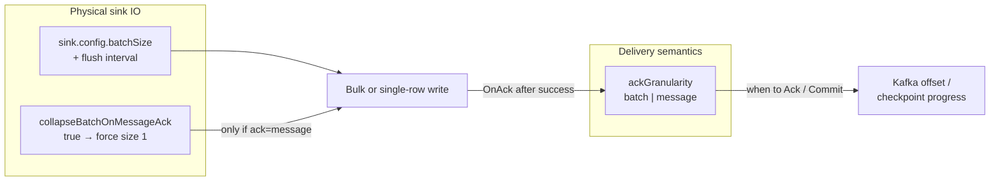
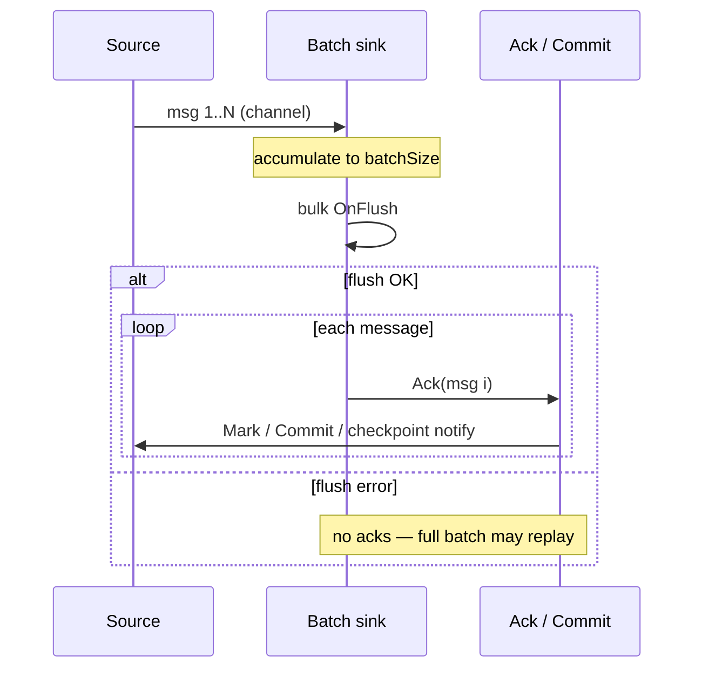

# Fault Tolerance and Data Consistency

DataFlow Operator processes messages with **at-least-once** delivery semantics. When the processor pod crashes or restarts, some messages may be re-read and written again. This document explains the behavior, risks of data desynchronization, and how to configure idempotent sinks to prevent duplicates.

## Delivery Semantics

- **At-least-once**: Each message is delivered at least once. Duplicates are possible on processor restart or crash.
- **Exactly-once**: Not supported natively. Use idempotent sinks to achieve effectively-once semantics.

## Source Behavior on Restart

| Source | State storage | On restart |
|--------|---------------|------------|
| **Kafka** | Consumer group (Kafka) | Resumes from last committed offset. No duplicates if offset was committed after sink write. |
| **PostgreSQL** | ConfigMap (default); in-memory when `checkpointPersistence: false` | By default resumes from last position. Without persistence: re-reads from beginning. |
| **PostgreSQL CDC** | ConfigMap (`lastAckedLSN`) | Resumes logical replication from last acked LSN after sink write. |
| **ClickHouse** | ConfigMap (default); in-memory when `checkpointPersistence: false` | By default resumes from last position. Without persistence: re-reads from beginning. |
| **Trino** | ConfigMap (default); in-memory when `checkpointPersistence: false` | By default resumes from last position. Without persistence: re-reads from beginning. |
| **Nessie** | ConfigMap when `incrementalBySnapshot: true` and `checkpointPersistence` (default) | Incremental reads along the Iceberg snapshot chain; without `incrementalBySnapshot`, full scan on every poll (no checkpoint). |
| **Iceberg** | ConfigMap when `incrementalBySnapshot: true` and `checkpointPersistence` (default) | Same as Nessie; checkpoint store key is `iceberg`. |

### Horizontal scaling (`spec.replicas`)

- **Kafka**: you may set `spec.replicas > 1`. All pods share one consumer group; parallelism is capped by the topic **partition** count.
- **PostgreSQL, PostgreSQL CDC, ClickHouse, Trino, Nessie**: `replicas` must be `1` (or unset). Multiple pods with a shared checkpoint ConfigMap will **duplicate** data.
- **DataFlowCron**: `replicas > 1` is not supported (one processor Job per schedule tick).

Within a single pod, raise `spec.transformWorkers` for CPU-heavy transforms (ordered emit) and rely on sink double-buffer flush — see [Architecture — Pipeline concurrency](architecture.md#pipeline-concurrency-implementation). Do not use extra replicas for polling sources.

### Kafka Source

The Kafka consumer marks offset **only after** the message is successfully written to the sink (via `msg.Ack()`). With `ackGranularity: message` (see below), offsets are also committed to the consumer group immediately after each mark.

If the processor crashes:

- **Before sink write**: Offset not committed. On restart, message is re-read. No duplicate in sink.
- **After sink write, before Ack**: Data may be in sink, offset not committed. On restart, re-read → duplicate in sink.
- **After Ack**: Offset marked (and committed when `ackGranularity: message`). On restart, resume from next message. No duplicate.

### Nessie source (incremental mode)

When `source.config.incrementalBySnapshot: true`, the processor reads only **new** Iceberg snapshots since the last `Ack`. Checkpoint (`lastAckedSnapshotID`, `lastAckedSnapshotSequence`) is stored in a ConfigMap when `snapshotCheckpoints` (default) and `spec.checkpointPersistence` are enabled.

See [nessie-incremental-snapshots-design.md](nessie-incremental-snapshots-design.md).

### Polling Sources (PostgreSQL, ClickHouse, Trino)

**Checkpoint persistence** is enabled by default. The read position (`lastReadChangeTime`, `lastReadOrderByValue`) is persisted to ConfigMap `df-<name>-checkpoint`. On restart, the source resumes from the last committed position after sink `Ack`, reducing duplicates. Set `checkpointPersistence: false` in spec to store checkpoint only in memory (lost on pod crash).

Legacy checkpoint keys (`lastReadID`, `lastReadTime`) are migrated on load; see the migration table below.

!!! warning "Idempotent sink required"
    For polling sources, always configure an **idempotent sink** (UPSERT, ReplacingMergeTree) to handle duplicates safely.

## Batch Sink Behavior

PostgreSQL, ClickHouse, and Trino sinks write in batches. The flow is:

1. Accumulate messages in a batch
2. Execute the batch write (PostgreSQL wraps all statements in a single transaction and commits atomically)
3. Call `Ack()` for each message in the batch (commits Kafka offset / advances polling checkpoint)

If the processor crashes **after a successful batch commit but before Ack**:

- Data is already in the sink
- Source offset / checkpoint may not be advanced
- On restart: re-read → **duplicate writes to sink** (safe with an idempotent sink)

!!! tip "Reduce duplicate window"
    Prefer a smaller sink `batchSize` with `ackGranularity: batch`, or use `ackGranularity: message`.
    With message ack, decide whether to keep bulk writes via [`collapseBatchOnMessageAck`](#decoupling-ack-and-sink-batch-speccollapsebatchonmessageack).

## Ack Granularity (`spec.ackGranularity`)

Controls **when** source offsets / checkpoints are considered committed relative to sink writes.
This is the *delivery watermark* for the source — not the physical size of the sink write.

| Value | Behavior |
|-------|----------|
| `batch` (default) | After a successful sink batch flush, all messages in that batch are acked together. Kafka source relies on the consumer auto-commit interval after `MarkMessage`. |
| `message` | After a successful sink write, each message is acked individually. For Kafka source, `Commit()` runs after each mark so the consumer-group offset advances sooner. |

Kafka **sink** always acks per message on the produce path regardless of `ackGranularity`.

!!! tip "Trino long-running INSERTs"
    For large JSON payloads and Iceberg/Nessie tables, keep `batchSize` low (often `1`) and set `sink.config.queryTimeoutSeconds` to cover the full Trino execution window (including `nextUri` polling).
    Timeouts during `nextUri` follow can happen after Trino already started processing the INSERT, so retries may produce duplicates.

## Decoupling ack and sink batch (`spec.collapseBatchOnMessageAck`) { #decoupling-ack-and-sink-batch-speccollapsebatchonmessageack }

Historically, `ackGranularity: message` also **forced** batch sinks to flush one row at a time
(`MaxBatchSize = 1`). That shrinks the duplicate window, but it destroys sink throughput
(N round-trips / N statements instead of one bulk write).

`collapseBatchOnMessageAck` makes that coupling **optional**:

| Value | Behavior |
|-------|----------|
| `true` (default) | Legacy coupling. With `ackGranularity: message`, sinks force `MaxBatchSize = 1` regardless of `sink.config.batchSize`. |
| `false` | Decoupled. Sink keeps `sink.config.batchSize` (and flush interval). After a **successful bulk flush**, the processor still runs **per-message** source ack (mark / `Commit()` / checkpoint notify). |
| *(ignored)* | When `ackGranularity` is `batch`, this field has no effect on batch size. |

### What each knob controls



| Knob | Controls | Does **not** control |
|------|----------|----------------------|
| `ackGranularity` | When source progress is committed (per batch vs per message after a successful write) | How many rows go in one INSERT/Append |
| `sink.config.batchSize` | Target physical write-batch size (and often flush timer) | Whether Kafka `Commit()` runs per mark |
| `collapseBatchOnMessageAck` | Whether message-ack **overrides** `batchSize` to `1` | Checkpoint debounce / `checkpointSyncOnAck` itself |

### Mode matrix

| `ackGranularity` | `collapseBatchOnMessageAck` | Effective sink batch | Source ack after flush | Typical use |
|------------------|----------------------------|----------------------|------------------------|-------------|
| `batch` | any | `batchSize` | One ack pass for the whole batch | Default / high throughput |
| `message` | `true` (default) | **Forced `1`** | Per message (and Kafka `Commit` per mark) | Minimal re-read window; low volume |
| `message` | `false` | `batchSize` | Per message **after** bulk success | High throughput + tighter offsets |

### Runtime sequence (`message` + `collapseBatchOnMessageAck: false`)

1. Sink accumulates up to `batchSize` (or flush interval).
2. One bulk `OnFlush` writes the batch (transaction / multi-VALUES / columnar insert — connector-specific).
3. On success, `AckAfterSuccessfulWrite` walks the batch and acks **each** message.
4. For Kafka source: each ack → `MarkMessage` + `Commit()` (message granularity).
5. If `checkpointSyncOnAck: true`, each ack may attempt a ConfigMap flush (coalesced by `checkpointSaveInterval`).

If step 2 fails, **no** messages in that batch are acked → at-least-once re-read of the whole batch on restart (use an idempotent sink).



### Duplicate window and crash semantics

Assume a crash **after** sink write succeeded but **before** all source acks finished:

| Mode | Worst-case re-read window (approx.) |
|------|-------------------------------------|
| `ackGranularity: batch` | Up to one full sink batch |
| `message` + collapse `true` | ~1 message (write and ack are 1:1) |
| `message` + collapse `false` | Up to messages in the in-flight bulk that were written but not yet individually acked (usually small; still **≤ batchSize**) |

At-least-once is unchanged in all modes: never ack before a successful sink write.
Idempotent sinks (`upsertMode` + `conflictKey`, ReplacingMergeTree, etc.) remain required when duplicates are unacceptable.

### Which sinks honor collapse / batchSize

`collapseBatchOnMessageAck` is applied when building the write loop for batch-oriented sinks:

- PostgreSQL
- ClickHouse
- Trino
- Nessie / Iceberg

Kafka sink does not use this batching helper; produce/ack behavior is separate.

### Interaction with `checkpointSyncOnAck`

- Polling / CDC checkpoints: `Save` queues state in memory; `checkpointSyncOnAck: true` calls `FlushAfterBatchAck` after ack (ConfigMap Get+Patch), coalesced by `checkpointSaveInterval` (default `30s`).
- With `ackGranularity: message` and collapse `false`, you still get **many** ack callbacks per bulk flush → more flush *attempts*, but coalesce limits API rate.
- Combining **high volume** + `message` + `checkpointSyncOnAck: true` without coalesce awareness can still pressure the API server; prefer `batch` ack for migration/cron unless you need a tight window, or keep sync-on-ack with a sane `checkpointSaveInterval`.

### Choosing a mode

| Goal | Recommended |
|------|-------------|
| Default streaming | `ackGranularity: batch`, tune `batchSize` |
| Smallest duplicate window, low/moderate rate | `ackGranularity: message` (collapse default `true`) |
| High Kafka → ClickHouse/Postgres throughput **and** faster offset commit | `ackGranularity: message` + `collapseBatchOnMessageAck: false` + large `batchSize` + idempotent sink |
| Migration / cron polling | Often `checkpointSyncOnAck: true` + idempotent sink; `ackGranularity: batch` unless you need message-level marks |

### Examples

**Legacy message-ack (batch collapsed to 1):**

```yaml
spec:
  ackGranularity: message
  # collapseBatchOnMessageAck: true  # default
  sink:
    type: postgresql
    config:
      upsertMode: true
      conflictKey: material_id
      batchSize: 100   # ignored while collapse is true
```

**High throughput: message ack without collapsing the sink batch:**

```yaml
spec:
  channelBufferSize: 1000
  ackGranularity: message
  collapseBatchOnMessageAck: false
  sink:
    type: clickhouse
    config:
      batchSize: 1000
      batchFlushIntervalSeconds: 5
      upsertMode: true
      conflictKey: event_id
```

See also sample `dataflow/config/samples/kafka-to-clickhouse-high-volume.yaml` and [Examples — high volume](examples.md).

## Idempotent Sink Configuration

### PostgreSQL Sink

Enable UPSERT mode so that duplicate inserts update existing rows instead of failing. Batch writes run inside an explicit transaction (all-or-nothing per flush).

```yaml
sink:
  type: postgresql
  config:
    connectionString: "postgres://..."
    table: output_table
    upsertMode: true
    conflictKey: id  # Optional; defaults to PRIMARY KEY
    # Optional: skip stale replays when a version column exists in the payload
    upsertStrategy: ifNewer   # always (default) | ifNewer
    upsertVersionColumn: updated_at  # required when upsertStrategy is ifNewer
```

Requires the table to have a PRIMARY KEY or UNIQUE constraint on the conflict columns. With `upsertStrategy: ifNewer`, updates apply only when `EXCLUDED.<version> > target.<version>`.

### ClickHouse Sink

Enable `upsertMode` for idempotent writes via `ReplacingMergeTree` (auto-created tables use this engine when `upsertMode: true`):

```yaml
sink:
  type: clickhouse
  config:
    connectionString: "clickhouse://..."
    table: output_table
    upsertMode: true
    conflictKey: id
    replacingVersionColumn: updated_at  # optional version column for ReplacingMergeTree
    tableEngine: ReplacingMergeTree     # optional; default when upsertMode is true
```

Or create the table manually:

```sql
CREATE TABLE output_table (
  id UInt64,
  data String,
  created_at DateTime DEFAULT now()
) ENGINE = ReplacingMergeTree(created_at)
ORDER BY id;
```

Duplicates may be visible until background merge; use `FINAL` or rely on merge for read-time deduplication.

### Trino Sink

For Iceberg catalogs, enable MERGE-based upsert:

```yaml
sink:
  type: trino
  config:
    serverURL: "http://trino:8080"
    catalog: iceberg   # catalog name must contain "iceberg"
    schema: default
    table: output_table
    upsertMode: true
    conflictKey: id
```

On match, rows are updated; there is no `ifNewer` version guard for Trino yet.

### Kafka Sink

By default the Kafka producer uses `requiredAcks: all` and `idempotent: true` (SyncProducer) for durability and to prevent duplicates on retry. You can tune produce behavior in sink `config`:

| Field | Default | Notes |
|-------|---------|--------|
| `requiredAcks` | `all` | `all` \| `local` \| `none`; idempotent requires `all` |
| `compression` | `none` | `none` \| `gzip` \| `snappy` \| `lz4` \| `zstd` |
| `idempotent` | `true` | When true, `maxOpenRequests` must be `1` |
| `async` | `false` | `true` → AsyncProducer; use with `flush*` for batching |
| `flushMessages` / `flushBytes` / `flushFrequency` | unset | Sarama produce flush thresholds (effective with `async: true`) |

Consumers should still handle potential duplicates (e.g., idempotent processing or deduplication by key) for end-to-end exactly-once semantics.

## Best Practices

1. **Use idempotent sinks** for PostgreSQL (UPSERT), ClickHouse (`upsertMode` / ReplacingMergeTree), and Trino Iceberg (MERGE) when using polling sources or when duplicates are possible.
2. **Kafka source**: Consumer group stores offset; at-least-once is preserved. Idempotent sink recommended for batch sinks. Use `ackGranularity: message` to shrink the re-read window; add `collapseBatchOnMessageAck: false` when you still need a large sink `batchSize`.
3. **batchSize** / **ackGranularity** / **collapseBatchOnMessageAck**: Treat delivery watermark and physical write size as separate knobs — see [Decoupling ack and sink batch](#decoupling-ack-and-sink-batch-speccollapsebatchonmessageack).
4. **Migration / cron workloads**: combine `checkpointSyncOnAck: true`, idempotent sink, and optionally `upsertStrategy: ifNewer` when a version column exists.
5. **Trino `queryTimeoutSeconds`**: Use a timeout large enough for peak load; too low values increase false failures on long INSERTs.
6. **batchFlushIntervalSeconds**: Shorter intervals flush more frequently, reducing in-flight data at risk.
7. **Error sink**: Configure `spec.errors` to capture failed messages for replay or analysis.

## Graceful Shutdown

On SIGTERM (e.g., pod eviction, node drain):

1. The processor receives the signal and cancels the context.
2. Sinks flush in-flight batches before exiting.
3. `PreStop: sleep 5` gives time for the load balancer to stop routing traffic.

Ensure `terminationGracePeriodSeconds` is sufficient for large batches to flush (default: 600 seconds).

## Checkpoint Persistence

!!! note "Enabled by default"
    The `checkpointPersistence` field in the DataFlow spec defaults to `true`. You do not need to set it explicitly — checkpoint persistence is enabled for all DataFlows with polling sources.

Checkpoint persistence is **enabled by default**. The read position (`lastReadChangeTime`, `lastReadOrderByValue`) is persisted to ConfigMap `df-<name>-checkpoint`. On processor restart, polling sources (PostgreSQL, ClickHouse, Trino) resume from the last committed position, reducing duplicates.

Canonical checkpoint JSON per source type:

```json
{
  "lastReadChangeTime": "2024-06-01T12:00:00.123456789Z",
  "lastReadOrderByValue": 5042
}
```

Legacy formats are normalized on load:

| Legacy | Canonical |
|--------|-----------|
| Trino: `{"lastReadID": 100}` | `{"lastReadOrderByValue": 100}` |
| ClickHouse: `{"lastReadID": 100, "lastReadTime": "..."}` | composite fields above |
| Time-only: `{"lastReadChangeTime": "..."}` | unchanged (single-column WHERE until order key appears) |

After restart, Trino/ClickHouse checkpoints that only had `lastReadID` use order-key filtering (`WHERE orderByColumn > N`) until the first ack with a timestamp; then tuple filtering `(changeTrackingColumn, orderByColumn) > (time, key)` applies.

To disable, set `checkpointPersistence: false`:

```yaml
apiVersion: dataflow.dataflow.io/v1
kind: DataFlow
metadata:
  name: my-dataflow
spec:
  checkpointPersistence: false  # Disable (default: true)
  source:
    type: postgresql
    # ...
```

The controller creates the ConfigMap and RBAC (ServiceAccount, Role, RoleBinding) for the processor. Checkpoint is saved with debounce (every 30 seconds by default) and on graceful shutdown.

### Sync checkpoint on ack (`spec.checkpointSyncOnAck`)

By default, pending checkpoints are flushed to the ConfigMap on a debounce timer (`checkpointSaveInterval`, default `30s`) and on graceful shutdown. After a pod crash, polling sources may re-read up to one debounce interval of data.

Set `checkpointSyncOnAck: true` to flush the checkpoint immediately after each sink batch ack (coalesced, not more often than `checkpointSaveInterval`). Recommended for migration and cron workloads:

```yaml
spec:
  checkpointSyncOnAck: true
  checkpointSaveInterval: 5s
  source:
    type: postgresql
    # ...
  sink:
    type: postgresql
    config:
      upsertMode: true
      conflictKey: material_id
```

## Checkpoint reset

To re-run a migration or cron job from the beginning without manually editing `df-<name>-checkpoint`:

```yaml
spec:
  checkpointReset: true   # one-shot; cleared by the controller after the next reconcile
```

Or set an annotation on the DataFlow:

```yaml
metadata:
  annotations:
    dataflow.dataflow.io/reset-checkpoint: "true"
```

The processor clears the persisted checkpoint for the source type on startup, then reads from the beginning.

## Strict idempotency (`spec.strictIdempotency`)

When `strictIdempotency: true`, admission rejects polling sources paired with a main sink that does not have `upsertMode` enabled. When `false` (default), a warning is emitted instead.

## Summary Checklist

| Scenario | Recommendation |
|----------|-----------------|
| PostgreSQL sink | `upsertMode: true` + `conflictKey`; `upsertStrategy: ifNewer` when version column exists |
| ClickHouse sink | `upsertMode: true` or manual `ReplacingMergeTree` + `ORDER BY` dedup key |
| Trino sink (Iceberg) | `upsertMode: true` + `conflictKey` |
| Kafka → batch sink | `ackGranularity: message` (+ optional `collapseBatchOnMessageAck: false` for throughput) or smaller `batchSize` + idempotent sink |
| Kafka source | Idempotent sink; `ackGranularity: message` for faster offset commit |
| Polling sources | Idempotent sink; `checkpointSyncOnAck: true` for migration/cron |
| batchSize vs ack | Keep separate: see `collapseBatchOnMessageAck` — do not assume message ack always means `batchSize: 1` |
