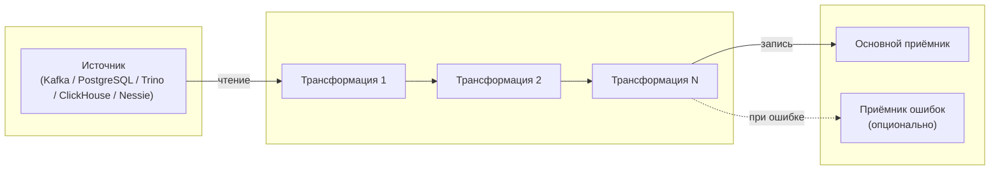
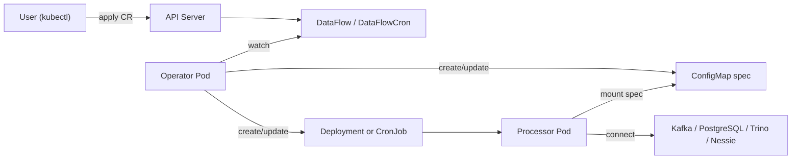
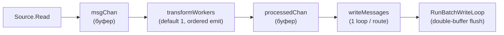

# Архитектура

Как работает DataFlow Operator: роль в Kubernetes, модель реконсиляции и поток данных в процессоре.

## Обзор

Оператор обеспечивает **декларативное управление конвейерами** через Kubernetes CR. Два CRD оркестрируют конвейеры по-разному:

| CRD | Workload | Документация |
|-----|----------|--------------|
| **DataFlow** | Постоянный Deployment | [DataFlow](dataflow/index.md) |
| **DataFlowCron** | CronJob + Job на тик | [DataFlowCron](dataflow-cron/index.md) |

См. [Типы нагрузки](concepts/workload-types.md).

Для **DataFlow**:

1. `kubectl apply` создаёт или обновляет ресурс.
2. Оператор создаёт **ConfigMap** и **Deployment**.
3. Под процессора выполняет: чтение → трансформация → запись.

### Поток данных (концептуально) { #поток-данных-концептуально }

**Источник** → **Трансформации** → **Приёмник** (опционально **Приёмник ошибок**).

Цепочка `transformations` на **одном** сообщении идёт по порядку списка. Между сообщениями возможен параллелизм через `spec.transformWorkers` — см. [Concurrency пайплайна](#pipeline-concurrency-implementation).

## Архитектура в Kubernetes

### Custom Resources

- **API group**: `dataflow.dataflow.io`
- **`DataFlow`** — см. [Spec](dataflow/spec.md), [Жизненный цикл](dataflow/lifecycle.md).
- **`DataFlowCron`** — см. [Spec](dataflow-cron/spec.md), [Триггеры](dataflow-cron/triggers.md).

Секреты через `SecretRef`; оператор подставляет их перед записью в ConfigMap.

### Deployment оператора

**controller-runtime**, **DataFlowReconciler** и **DataFlowCronReconciler**, **Leader election** (`dataflow-operator.dataflow.io`).

### Admission Webhook (Validating) { #admission-webhook-validating }

При включении валидирует **DataFlow** и **DataFlowCron** на порту 9443 до записи в etcd. См. [Настройка Validating Webhook](development.md#настройка-validating-webhook).

---

## Схема в Kubernetes

---

## Процессор данных (рантайм)

**Процessor** читает из источника, применяет трансформации, пишет в приёмник(и). Одинаковый бинарник для Deployment и CronJob Job.

### Структура

- **Source**, **Sink**, **Error sink**, **Transformations**, **Router sinks**
- Checkpoint для polling-источников при `checkpointPersistence: true`

### Поток

Connect → Read → Process (трансформации) → Write (main / router / error sink).

### Concurrency пайплайна (реализация) { #pipeline-concurrency-implementation }

Внутри одного пода конвейер **разбит на стадии через Go-каналы**. Transform может идти в worker pool; flush sink перекрывается с накоплением следующего batch (double-buffer).

| Стадия | Реализация | Параллелизм |
|--------|------------|-------------|
| Источник → процессор | `source.Read` → `msgChan` | Буфер `channelBufferSize` (по умолчанию **100**) |
| Трансформации | `processMessages` | `transformWorkers` goroutine (default **1**); цепочка `0..N` на сообщение; **reorder buffer** сохраняет порядок emit |
| Процессор → sink | `processedChan` | Блокирующий send (backpressure) |
| Запись в sink | `RunBatchWriteLoop` | Не больше одного `OnFlush` in-flight; параллельно копится следующий batch |
| Router | Канал + goroutine на условие | Fan-out по routes; внутри каждого — один loop |

**`transformWorkers`.** Увеличивайте при CPU-тяжёлых трансформациях. Порядок записи в sink = порядок входа. Диапазон: 1–64.

**Backpressure.** Полный буфер блокирует send. См. [Best Practices — буфер](best-practices.md#buffer-sizing).

**Ack и порядок.** Source ack — **барьер**: родитель помечается доставленным только после ack всех производных (1→N). Filter (0 выходов) ack сразу. При `transformWorkers > 1` reorder buffer сохраняет порядок.

**Ack vs размер sink batch.** `spec.ackGranularity` задаёт *когда* фиксируется прогресс источника (`batch` vs `message`). Отдельно `spec.collapseBatchOnMessageAck` (по умолчанию `true`) решает, схлопывает ли message-ack sink до `MaxBatchSize = 1`. При `false` bulk-запись сохраняется, а per-message ack идёт после успешного flush. Подробнее: [Отказоустойчивость — развязка ack и sink batch](fault-tolerance.md#развязка-ack-и-sink-batch-speccollapsebatchonmessageack).

**Double-buffer flush.** Пока flush batch N, loop читает batch N+1 (лимит: один in-flight + один active). Порядок flush/ack сохраняется. Кастомные write loop (например PostgreSQL) пока без double-buffer.

**Горизонтальный scale (`replicas`).** `replicas > 1` только для **Kafka**. Иначе — `resources`, `channelBufferSize`, `transformWorkers`, `readBatchSize` / `batchSize`.

**Якоря:** `process_transform.go`, `batch_writer.go`, `dataflow_types.go` (`transformWorkers`).

Subprocess-коннекторы: `DATAFLOW_USE_SUBPROCESS_CONNECTORS=1` — см. [Протокол коннекторов](connector-protocol.md).

---

## Кратко

- **DataFlow**: ConfigMap + Deployment, непрерывная работа.
- **DataFlowCron**: ConfigMap + CronJob, прогон по расписанию, опциональные trigger Job.
- **Рантайм**: один конвейер; опциональный transform worker pool с ordered emit и double-buffer flush (см. [Concurrency пайплайна](#pipeline-concurrency-implementation)).

## См. также

- [DataFlow](dataflow/index.md) · [DataFlowCron](dataflow-cron/index.md)
- [Начало работы](getting-started.md)
- [Best Practices](best-practices.md) — `channelBufferSize`, `transformWorkers`, batch sizes, `replicas`
