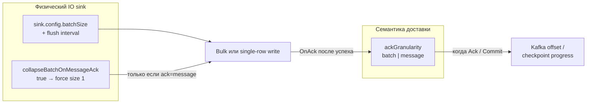
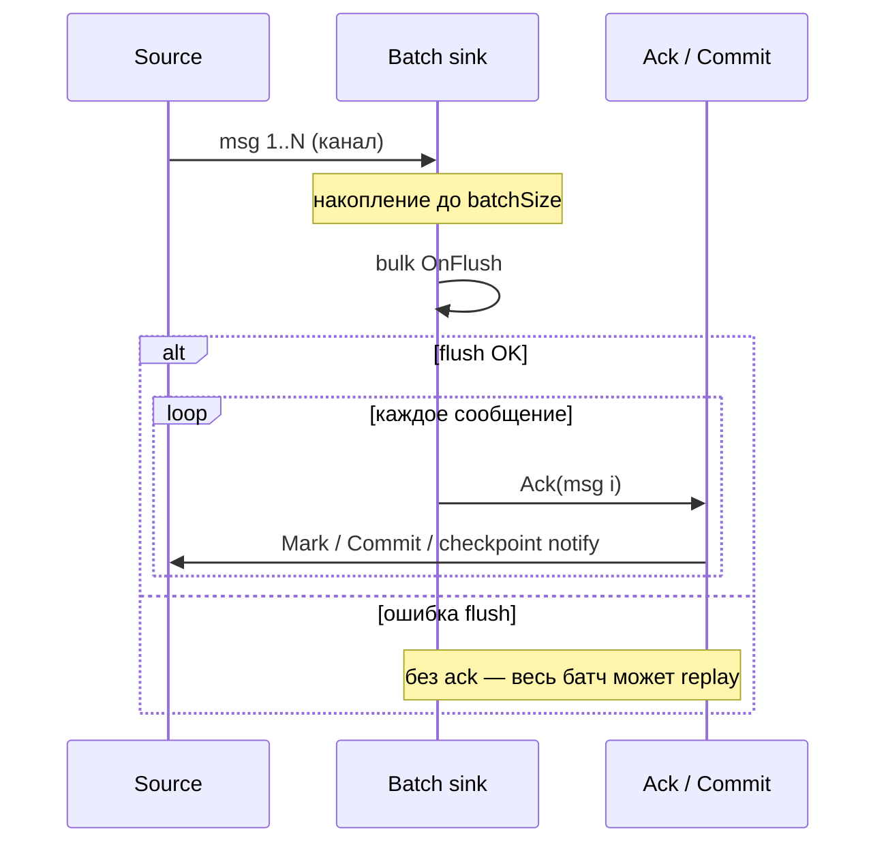

# Отказоустойчивость и консистентность данных

DataFlow Operator обрабатывает сообщения с семантикой **at-least-once** (минимум один раз). При падении или перезапуске пода процессора некоторые сообщения могут быть прочитаны и записаны повторно. В этом документе описано поведение, риски рассинхрона данных и настройка идемпотентных sink для предотвращения дубликатов.

## Семантика доставки

- **At-least-once**: Каждое сообщение доставляется минимум один раз. Дубликаты возможны при перезапуске или падении процессора.
- **Exactly-once**: Не поддерживается нативно. Используйте идемпотентные sink для достижения effectively-once.

## Поведение источников при перезапуске

| Источник | Хранение состояния | При перезапуске |
|----------|-------------------|-----------------|
| **Kafka** | Consumer group (Kafka) | Продолжает с последнего закоммиченного offset. Без дубликатов, если offset закоммичен после записи в sink. |
| **PostgreSQL** | ConfigMap (по умолчанию); в памяти при `checkpointPersistence: false` | По умолчанию продолжает с последней позиции. Без персистенции: перечитывает с начала. |
| **PostgreSQL CDC** | ConfigMap (`lastAckedLSN`) | Продолжает logical replication с последнего acked LSN после записи в sink. |
| **ClickHouse** | ConfigMap (по умолчанию); в памяти при `checkpointPersistence: false` | По умолчанию продолжает с последней позиции. Без персистенции: перечитывает с начала. |
| **Trino** | ConfigMap (по умолчанию); в памяти при `checkpointPersistence: false` | По умолчанию продолжает с последней позиции. Без персистенции: перечитывает с начала. |
| **Nessie** | ConfigMap при `incrementalBySnapshot: true` и `checkpointPersistence` (по умолчанию) | Инкрементальное чтение по цепочке Iceberg snapshot (file-level delta добавленных data files при возможности); без `incrementalBySnapshot` — полный scan на каждом poll (checkpoint не используется). |
| **Iceberg** | ConfigMap при `incrementalBySnapshot: true` и `checkpointPersistence` (по умолчанию) | Как у Nessie; ключ checkpoint — `iceberg`. |

### Горизонтальное масштабирование (`spec.replicas`)

- **Kafka**: можно задать `spec.replicas > 1`. Все поды используют один consumer group; параллелизм ограничен числом **партиций** топика.
- **PostgreSQL, PostgreSQL CDC, ClickHouse, Trino, Nessie**: `replicas` должен быть `1` (или не задан). Несколько подов с общим checkpoint ConfigMap приведут к **дублированию** данных.
- **DataFlowCron**: `replicas > 1` не поддерживается (один Job процессора на тик расписания).

Внутри одного пода для CPU-тяжёлых transforms увеличивайте `spec.transformWorkers` (порядок emit сохраняется); sink использует double-buffer flush — см. [Архитектура — concurrency пайплайна](architecture.md#pipeline-concurrency-implementation). Не поднимайте `replicas` для polling-источников.

### Kafka источник

Consumer Kafka помечает offset **только после** успешной записи сообщения в sink (через `msg.Ack()`). При `ackGranularity: message` (см. ниже) offset также сразу коммитится в consumer group.

При падении процессора:

- **До записи в sink**: Offset не закоммичен. При перезапуске сообщение перечитывается. Дубликата в sink нет.
- **После записи в sink, до Ack**: Данные могут быть в sink, offset не закоммичен. При перезапуске перечитывание → дубликат в sink.
- **После Ack**: Offset помечен (и закоммичен при `ackGranularity: message`). При перезапуске продолжение со следующего сообщения. Дубликата нет.

### Nessie источник (инкрементальный режим)

При `source.config.incrementalBySnapshot: true` процессор читает только **новые** Iceberg snapshot с момента последнего `Ack`. Внутри нового snapshot предпочтительны добавленные data files относительно parent (пустой delta пропускает scan; append-only parquet без deletes — прямой file read). Checkpoint (`lastAckedSnapshotID`, `lastAckedSnapshotSequence`) сохраняется в ConfigMap, если включены `snapshotCheckpoints` (по умолчанию) и `spec.checkpointPersistence`. Опционально `maxRowsPerPoll` / `maxBytesPerPoll` ограничивают объём за poll.

Подробнее: [коннектор Nessie](connectors.md#nessie).

### Polling источники (PostgreSQL, ClickHouse, Trino)

**Персистенция checkpoint включена по умолчанию.** Позиция чтения (`lastReadChangeTime`, `lastReadOrderByValue`) сохраняется в ConfigMap `df-<name>-checkpoint`. После перезапуска источник продолжает с последней позиции после `Ack` sink. Задайте `checkpointPersistence: false`, чтобы хранить checkpoint только в памяти (теряется при падении пода).

Legacy-ключи (`lastReadID`, `lastReadTime`) мигрируются при загрузке; см. таблицу миграции ниже.

При `checkpointPersistence: false` при падении пода:

- Состояние теряется.
- При перезапуске источник перечитывает с начала (или с неверной позиции).
- Возможны **дубликаты** или **пропуски** в зависимости от момента падения.

**Персистенция checkpoint** включена по умолчанию. Позиция сохраняется в ConfigMap. При перезапуске источник возобновляет чтение с последней закоммиченной позиции, уменьшая дубликаты. Задайте `checkpointPersistence: false` в spec, чтобы отключить.

!!! warning "Требуется идемпотентный sink"
    Для polling источников всегда настраивайте **идемпотентный sink** (UPSERT, ReplacingMergeTree) для безопасной обработки дубликатов.

## Поведение batch sink

PostgreSQL, ClickHouse и Trino sink пишут батчами. Последовательность:

1. Накопление сообщений в батч
2. Выполнение batch-записи (PostgreSQL оборачивает все statements одной транзакцией и коммитит атомарно)
3. Вызов `Ack()` для каждого сообщения батча (коммит Kafka offset / продвижение polling checkpoint)

Если процессор падает **после успешного commit батча, но до Ack**:

- Данные уже в sink
- Позиция источника / checkpoint может быть не продвинута
- При перезапуске: перечитывание → **дублирование записей в sink** (безопасно с идемпотентным sink)

!!! tip "Уменьшение окна дубликатов"
    Предпочтительнее меньший sink `batchSize` при `ackGranularity: batch`, либо `ackGranularity: message`.
    При message-ack решите, сохранять ли bulk-запись через [`collapseBatchOnMessageAck`](#развязка-ack-и-sink-batch-speccollapsebatchonmessageack).

## Гранулярность ack (`spec.ackGranularity`)

Управляет **моментом**, когда offset / checkpoint источника считаются зафиксированными относительно записи в sink.
Это *watermark доставки* для источника — не физический размер write-batch sink.

| Значение | Поведение |
|----------|-----------|
| `batch` (по умолчанию) | После успешного flush batch sink все сообщения батча ack'аются вместе. Kafka source полагается на auto-commit consumer group после `MarkMessage`. |
| `message` | После успешной записи каждое сообщение ack'ается отдельно. Для Kafka source после каждого mark вызывается `Commit()`, чтобы offset consumer group продвигался быстрее. |

Kafka **sink** всегда ack'ает по сообщению на produce-пути, независимо от `ackGranularity`.

!!! tip "Длительные INSERT в Trino"
    Для крупных JSON и таблиц Iceberg/Nessie держите `batchSize` небольшим (часто `1`) и задавайте `sink.config.queryTimeoutSeconds` так, чтобы покрыть всё время выполнения запроса (включая polling `nextUri`).
    Таймаут на этапе `nextUri` может произойти уже после старта INSERT в Trino, поэтому повторный запуск может дать дубликаты.

## Развязка ack и sink batch (`spec.collapseBatchOnMessageAck`) { #развязка-ack-и-sink-batch-speccollapsebatchonmessageack }

Исторически `ackGranularity: message` также **принудительно** заставлял batch sink сбрасывать по одной строке
(`MaxBatchSize = 1`). Это сужает окно дубликатов, но убивает throughput sink
(N round-trip / N statement вместо одной bulk-записи).

`collapseBatchOnMessageAck` делает эту связь **опциональной**:

| Значение | Поведение |
|----------|-----------|
| `true` (по умолчанию) | Legacy-связь. При `ackGranularity: message` sink принудительно ставит `MaxBatchSize = 1`, игнорируя `sink.config.batchSize`. |
| `false` | Развязка. Sink сохраняет `sink.config.batchSize` (и flush interval). После **успешного bulk flush** процессор всё равно делает **per-message** source ack (mark / `Commit()` / checkpoint notify). |
| *(игнорируется)* | При `ackGranularity: batch` поле не влияет на размер батча. |

### Что контролирует каждый параметр



| Параметр | Контролирует | **Не** контролирует |
|----------|--------------|---------------------|
| `ackGranularity` | Когда фиксируется прогресс источника (на батч vs на сообщение после успешной записи) | Сколько строк уходит в один INSERT/Append |
| `sink.config.batchSize` | Целевой размер физического write-batch (и часто таймер flush) | Вызывается ли Kafka `Commit()` на каждый mark |
| `collapseBatchOnMessageAck` | Переопределяет ли message-ack `batchSize` в `1` | Сам debounce checkpoint / факт включения `checkpointSyncOnAck` |

### Матрица режимов

| `ackGranularity` | `collapseBatchOnMessageAck` | Эффективный sink batch | Source ack после flush | Типичный кейс |
|------------------|----------------------------|------------------------|------------------------|---------------|
| `batch` | любое | `batchSize` | Один проход ack на весь батч | Default / высокий throughput |
| `message` | `true` (по умолчанию) | **Принудительно `1`** | На каждое сообщение (и Kafka `Commit` на mark) | Минимальное окно re-read; небольшой объём |
| `message` | `false` | `batchSize` | На каждое сообщение **после** успеха bulk | Высокий throughput + более быстрый offset commit |

### Последовательность в runtime (`message` + `collapseBatchOnMessageAck: false`)

1. Sink накапливает до `batchSize` (или срабатывает flush interval).
2. Один bulk `OnFlush` пишет батч (транзакция / multi-VALUES / columnar insert — зависит от коннектора).
3. При успехе `AckAfterSuccessfulWrite` проходит по батчу и ack'ает **каждое** сообщение.
4. Для Kafka source: каждый ack → `MarkMessage` + `Commit()` (message granularity).
5. При `checkpointSyncOnAck: true` каждый ack может инициировать flush ConfigMap (с coalescing по `checkpointSaveInterval`).

Если шаг 2 падает, **ни одно** сообщение батча не ack'ается → at-least-once перечитывание всего батча при рестарте (нужен идемпотентный sink).



### Окно дубликатов и семантика при crash

Предположим crash **после** успешной записи в sink, но **до** завершения всех source ack:

| Режим | Худшее окно re-read (примерно) |
|-------|--------------------------------|
| `ackGranularity: batch` | До одного полного sink batch |
| `message` + collapse `true` | ~1 сообщение (write и ack 1:1) |
| `message` + collapse `false` | Сообщения из in-flight bulk, уже записанные, но ещё не индивидуально ack'нутые (обычно мало; всё равно **≤ batchSize**) |

At-least-once сохраняется во всех режимах: ack никогда не раньше успешной записи в sink.
Идемпотентные sink (`upsertMode` + `conflictKey`, ReplacingMergeTree и т.п.) по-прежнему нужны, если дубликаты недопустимы.

### Какие sink учитывают collapse / batchSize

`collapseBatchOnMessageAck` применяется при сборке write loop для batch-ориентированных sink:

- PostgreSQL
- ClickHouse
- Trino
- Nessie / Iceberg

Kafka sink не использует этот batching helper; поведение produce/ack отдельное.

### Взаимодействие с `checkpointSyncOnAck`

- Checkpoint polling / CDC: `Save` кладёт состояние в память; `checkpointSyncOnAck: true` вызывает `FlushAfterBatchAck` после ack. Flush **неблокирующий** (фоновый worker) и coalesced по `checkpointSaveInterval` (по умолчанию `30s`) — ack path не ждёт ConfigMap Get+Patch.
- При `ackGranularity: message` и collapse `false` на один bulk flush приходится **много** ack-колбэков → больше *попыток* flush, но coalesce + async ограничивают частоту API и не тормозят пайплайн.
- Связка **высокий объём** + `message` + `checkpointSyncOnAck: true` без учёта coalesce всё ещё может нагружать API server; для migration/cron чаще достаточно `batch` ack, либо sync-on-ack с разумным `checkpointSaveInterval`.

### Как выбрать режим

| Цель | Рекомендация |
|------|--------------|
| Обычный streaming | `ackGranularity: batch`, тюнить `batchSize` |
| Минимальное окно дубликатов, низкий/средний объём | `ackGranularity: message` (collapse по умолчанию `true`) |
| Высокий Kafka → ClickHouse/Postgres throughput **и** быстрый offset commit | `ackGranularity: message` + `collapseBatchOnMessageAck: false` + крупный `batchSize` + идемпотентный sink |
| Migration / cron polling | Часто `checkpointSyncOnAck: true` + идемпотентный sink; `ackGranularity: batch`, если не нужны message-level marks |

### Примеры

**Legacy message-ack (батч схлопнут до 1):**

```yaml
spec:
  ackGranularity: message
  # collapseBatchOnMessageAck: true  # по умолчанию
  sink:
    type: postgresql
    config:
      upsertMode: true
      conflictKey: material_id
      batchSize: 100   # игнорируется, пока collapse = true
```

**Высокий throughput: message ack без схлопывания sink batch:**

```yaml
spec:
  channelBufferSize: 1000
  ackGranularity: message
  collapseBatchOnMessageAck: false
  sink:
    type: clickhouse
    config:
      batchSize: 1000
      batchFlushIntervalSeconds: 5
      upsertMode: true
      conflictKey: event_id
```

См. также sample `dataflow/config/samples/kafka-to-clickhouse-high-volume.yaml` и [Примеры — high volume](examples.md).

## Настройка идемпотентного sink

### PostgreSQL sink

Включите UPSERT, чтобы дубликаты обновляли существующие строки. Batch-записи выполняются в явной транзакции (всё или ничего за flush).

```yaml
sink:
  type: postgresql
  config:
    connectionString: "postgres://..."
    table: output_table
    upsertMode: true
    conflictKey: id  # Опционально; по умолчанию PRIMARY KEY
    upsertStrategy: ifNewer   # always (по умолчанию) | ifNewer
    upsertVersionColumn: updated_at  # обязательно при upsertStrategy: ifNewer
```

Требуется PRIMARY KEY или UNIQUE на колонках конфликта. При `upsertStrategy: ifNewer` обновление выполняется только если `EXCLUDED.<version> > target.<version>`.

### ClickHouse sink

Включите `upsertMode` для идемпотентной записи через `ReplacingMergeTree` (при автосоздании таблицы этот движок используется при `upsertMode: true`):

```yaml
sink:
  type: clickhouse
  config:
    connectionString: "clickhouse://..."
    table: output_table
    upsertMode: true
    conflictKey: id
    replacingVersionColumn: updated_at
    tableEngine: ReplacingMergeTree
```

Или создайте таблицу вручную:

```sql
CREATE TABLE output_table (
  id UInt64,
  data String,
  created_at DateTime DEFAULT now()
) ENGINE = ReplacingMergeTree(created_at)
ORDER BY id;
```

Дубликаты могут быть видны до background merge; для чтения используйте `FINAL` или полагайтесь на merge.

### Trino sink

Для Iceberg-каталогов включите MERGE-based upsert:

```yaml
sink:
  type: trino
  config:
    serverURL: "http://trino:8080"
    catalog: iceberg   # имя каталога должно содержать "iceberg"
    schema: default
    table: output_table
    upsertMode: true
    conflictKey: id
```

При совпадении строка обновляется; `ifNewer` по колонке версии для Trino пока не поддерживается.

### Kafka sink

По умолчанию producer Kafka использует `requiredAcks: all`, `idempotent: true`, `compression: snappy` и `async: true` (AsyncProducer с flush defaults 100 сообщений / 100ms) для надёжного батчевого produce. Параметры задаются в `config` sink:

| Поле | По умолчанию | Заметки |
|------|--------------|---------|
| `requiredAcks` | `all` | `all` \| `local` \| `none`; для idempotent нужен `all` |
| `compression` | `snappy` | `none` \| `gzip` \| `snappy` \| `lz4` \| `zstd` |
| `idempotent` | `true` | При true `maxOpenRequests` должен быть `1` |
| `async` | `true` | `false` → SyncProducer (исторический RTT на сообщение) |
| `flushMessages` / `flushBytes` / `flushFrequency` | 100 / не задан / 100ms при async | Пороги flush Sarama |

Consumers по-прежнему должны обрабатывать возможные дубликаты (например, идемпотентной обработкой или дедупликацией по ключу) для end-to-end exactly-once.

## Рекомендации

1. **Используйте идемпотентные sink** для PostgreSQL (UPSERT), ClickHouse (`upsertMode` / ReplacingMergeTree) и Trino Iceberg (MERGE) при polling источниках или когда возможны дубликаты.
2. **Kafka источник**: Consumer group хранит offset; at-least-once сохраняется. Идемпотентный sink для batch sink. `ackGranularity: message` сужает окно re-read; добавьте `collapseBatchOnMessageAck: false`, если нужен крупный sink `batchSize`.
3. **batchSize** / **ackGranularity** / **collapseBatchOnMessageAck**: Watermark доставки и физический размер записи — разные рычаги; см. [Развязка ack и sink batch](#развязка-ack-и-sink-batch-speccollapsebatchonmessageack).
4. **Migration / cron**: `checkpointSyncOnAck: true`, идемпотентный sink, при наличии колонки версии — `upsertStrategy: ifNewer`.
5. **Trino `queryTimeoutSeconds`**: Таймаут с запасом под пиковую нагрузку.
6. **batchFlushIntervalSeconds**: Меньшие интервалы чаще сбрасывают батч.
7. **Error sink**: Настройте `spec.errors` для неудачных сообщений.

## Graceful shutdown

При SIGTERM (например, eviction пода, drain ноды):

1. Процессор получает сигнал и отменяет контекст.
2. Sink сбрасывают in-flight батчи перед выходом.
3. `PreStop: sleep 5` даёт время load balancer перестать направлять трафик.

Убедитесь, что `terminationGracePeriodSeconds` достаточен для сброса больших батчей (по умолчанию: 600 секунд).

## Персистенция checkpoint

!!! note "По умолчанию включено"
    Поле `checkpointPersistence` в spec DataFlow по умолчанию равно `true`. Явно указывать его не требуется — персистенция checkpoint включена для всех DataFlow с polling-источниками.

Персистенция checkpoint **включена по умолчанию**. Позиция чтения (`lastReadChangeTime`, `lastReadOrderByValue`) сохраняется в ConfigMap `df-<name>-checkpoint`. При перезапуске процессора polling источники (PostgreSQL, ClickHouse, Trino) возобновляют чтение с последней закоммиченной позиции, уменьшая дубликаты.

Канонический JSON checkpoint для каждого типа источника:

```json
{
  "lastReadChangeTime": "2024-06-01T12:00:00.123456789Z",
  "lastReadOrderByValue": 5042
}
```

Legacy-форматы нормализуются при загрузке:

| Legacy | Canonical |
|--------|-----------|
| Trino: `{"lastReadID": 100}` | `{"lastReadOrderByValue": 100}` |
| ClickHouse: `{"lastReadID": 100, "lastReadTime": "..."}` | composite поля выше |
| Только time: `{"lastReadChangeTime": "..."}` | без изменений (одноколоночный WHERE до появления order key) |

После перезапуска checkpoint Trino/ClickHouse только с `lastReadID` использует фильтр по order key (`WHERE orderByColumn > N`) до первого ack с timestamp; затем включается tuple `(changeTrackingColumn, orderByColumn) > (time, key)`.

Чтобы отключить, задайте `checkpointPersistence: false`:

```yaml
apiVersion: dataflow.dataflow.io/v1
kind: DataFlow
metadata:
  name: my-dataflow
spec:
  checkpointPersistence: false  # Отключить (по умолчанию: true)
  source:
    type: postgresql
    # ...
```

Контроллер создаёт ConfigMap и RBAC (ServiceAccount, Role, RoleBinding) для процессора. Checkpoint сохраняется с debounce (по умолчанию раз в 30 секунд) и при graceful shutdown.

### Синхронизация checkpoint при ack (`spec.checkpointSyncOnAck`)

По умолчанию pending checkpoint сбрасывается в ConfigMap по таймеру debounce (`checkpointSaveInterval`, по умолчанию `30s`) и при graceful shutdown. После падения пода polling-источники могут перечитать данные за один интервал debounce.

При `checkpointSyncOnAck: true` после каждого ack батча sink запрашивается flush checkpoint. Flush **асинхронный** (не блокирует ack path) и по-прежнему coalesced, не чаще `checkpointSaveInterval`. Рекомендуется для migration и cron:

```yaml
spec:
  checkpointSyncOnAck: true
  checkpointSaveInterval: 5s
  source:
    type: postgresql
  sink:
    type: postgresql
    config:
      upsertMode: true
      conflictKey: material_id
```

## Сброс checkpoint

Для повторного полного прогона migration/cron без ручного редактирования `df-<name>-checkpoint`:

```yaml
spec:
  checkpointReset: true   # one-shot; контроллер сбрасывает флаг после reconcile
```

Или annotation на DataFlow:

```yaml
metadata:
  annotations:
    dataflow.dataflow.io/reset-checkpoint: "true"
```

Процессор очищает checkpoint для типа источника при старте и читает с начала.

## Strict idempotency (`spec.strictIdempotency`)

При `strictIdempotency: true` admission отклоняет polling-источники с неидемпотентным main sink (без `upsertMode`). По умолчанию (`false`) выдаётся warning.

## Чеклист

| Сценарий | Рекомендация |
|----------|--------------|
| PostgreSQL sink | `upsertMode: true` + `conflictKey`; `upsertStrategy: ifNewer` при колонке версии |
| ClickHouse sink | `upsertMode: true` или ручной `ReplacingMergeTree` + `ORDER BY` |
| Trino sink (Iceberg) | `upsertMode: true` + `conflictKey` |
| Kafka → batch sink | `ackGranularity: message` (+ опционально `collapseBatchOnMessageAck: false` для throughput) или меньший `batchSize` + идемпотентный sink |
| Kafka источник | Идемпотентный sink; `ackGranularity: message` для быстрого commit offset |
| Polling источники | Идемпотентный sink; `checkpointSyncOnAck: true` для migration/cron |
| batchSize vs ack | Держите раздельно: см. `collapseBatchOnMessageAck` — message-ack не всегда означает `batchSize: 1` |
